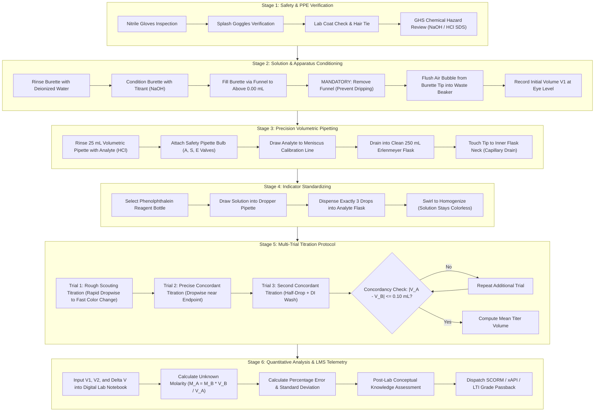
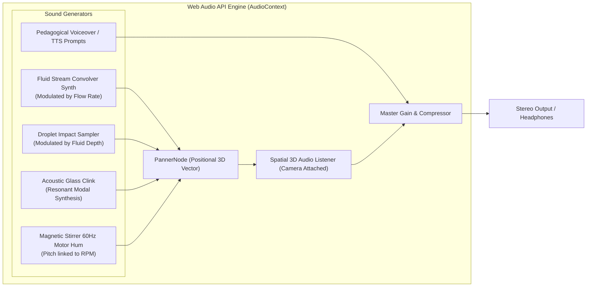
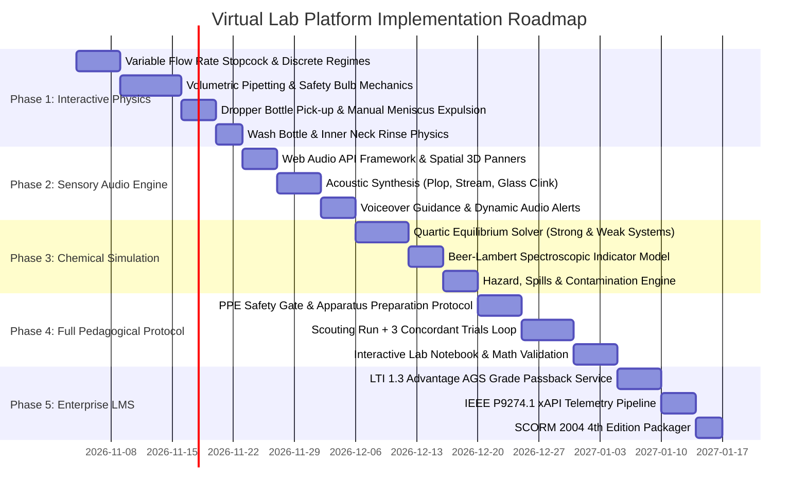

# Reverse-Engineering Specification: PraxiLabs-Grade Virtual Science Laboratory Platform

> **Document Status:** Governing Architecture & Implementation Contract  
> **Target Audience:** All Software Engineers, Autonomous AI Agents, Domain Chemists, and Instruction Designers  
> **System Objective:** Complete, uncompromising clean-room reverse engineering of PraxiLabs (and Labster-class) virtual laboratory simulation platforms for high-performance browser runtimes.

---

## 1. Executive Mandate & Strategic Vision

The purpose of this project is to build a browser-native, curriculum-aligned, interactive 3D virtual science laboratory capable of substituting physical university-level chemistry and biology wet labs.

Virtual science platforms like **PraxiLabs** and **Labster** are not toy games or decorative 3D models; they are rigorous pedagogical, computational, and procedural simulation engines. They enforce:
1. **Scientific Integrity**: Experiments run on computational chemical/physical models, not hardcoded animations.
2. **Procedural Rigor**: Full end-to-end laboratory protocols—from Personal Protective Equipment (PPE) checks, apparatus cleaning/rinsing, volumetric pipetting, and titration scouting runs, to multiple concordant trials and quantitative uncertainty analysis.
3. **Tactile Laboratory Mechanics**: 6-DoF object handling, granular variable-flow valves, eye-level parallax meniscus alignment, volumetric pipette safety bulbs, and analytical balance taring.
4. **Multisensory Feedback**: Positional 3D acoustics (glass clinks, droplet plops, variable flow streams, motor hums), tactile visual responses, and real-time interactive pedagogy.
5. **Institutional Compliance**: SCORM 2004 4th Edition, LTI 1.3 Advantage Grade Passback, and fine-grained xAPI (Tin Can) learning analytics.

Every agent and engineer contributing to this repository must adhere to the engineering standards, architecture, and phase milestones detailed in this document. Superficial shortcuts, fake button triggers, and cosmetic mockups are strictly prohibited.

---

## 2. Current State Audit & Brutally Honest Gap Analysis

### 2.1. Active Baseline (Current Capabilities)
The existing workspace (`src/`) has established a solid graphical and visual presentation:
* **Visual Glassware Fidelity**: DIN EN ISO 385 Class AS borosilicate burette with calibrated graduation scale, rear-wall Schellbach contrast stripe, rotating PTFE stopcock model, and double-walled lathe-geometry Erlenmeyer flask.
* **Laboratory Environment**: Realistic cleanroom bench, service raceway with duplex outlets and vacuum turrets, cast-iron retort stand with non-clipping articulated clamps and porcelain contrast plate, PBR instruments, and studio lighting.
* **Camera System**: Full 360° orbit rotation, screen-space panning (right-click / 2-finger drag), wide zoom range ($0.08\text{ m}$ to $6.0\text{ m}$), and smooth preset alignment.
* **Elementary Titration Loop**: 5-step linear progression for Strong Acid–Strong Base ($\text{HCl} + \text{NaOH}$), simple mathematical pH formula, phenolphthalein color response, droplet fall effect, and in-memory xAPI log.

### 2.2. Brutally Honest Gap Analysis: What is Broken, Fragile, or Fake

| Subsystem | PraxiLabs Benchmark | Current Application State | Gap Classification |
| :--- | :--- | :--- | :--- |
| **Workflow Arc** | Complete protocol: PPE inspection $\to$ solution prep $\to$ burette wash & rinse with titrant $\to$ bubble clearing $\to$ volumetric pipetting $\to$ scout titration $\to$ 3 concordant trials $\to$ calculations. | Starts abruptly with a pre-filled burette and pre-filled flask. No preparation, no pipetting, single-shot trial. | **Critical Architectural Deficit** |
| **Burette Valve Control** | Continuous multi-rate stopcock: fully closed ($0^\circ$), micro-drop ($15^\circ$), dropwise ($30^\circ$, $0.05\text{ mL/drop}$), stream ($90^\circ$, $1.5\text{ mL/s}$), and tip-hanging half-drop wash. | Binary toggle switch (On/Off) draining at fixed $1.5\text{ mL/s}$. Behaves like a reaction-time mini-game. | **Physical Mechanics Deficit** |
| **Object Manipulation** | Freeform hand-held manipulation: picking up pipettes, uncapping bottles, holding droppers over vessels, dispensing into arbitrary containers. | Hardcoded click-to-teleport triggers. Flask snaps to one fixed socket; indicator bottle cannot be held or manipulated. | **Interaction Deficit** |
| **Bench Equipment** | Interactive instruments: functional analytical balances with tare & draft doors, magnetic stirrers with RPM knobs, pH meters with calibration buffers. | Static 3D decorative models (balance, oven, stirrer, centrifuge, spatula, vial rack) with zero interactive functionality. | **Simulation Realism Deficit** |
| **Acoustic Engine** | Spatial 3D Web Audio: liquid pouring, droplet impact plop, glass-on-porcelain clinks, stopcock friction, motor hum, voiceover guidance. | Completely silent. No sound synthesis, no sample triggers, no auditory feedback. | **Sensory Deficit** |
| **Chemical Engine** | Dynamic chemical equilibrium engine: multi-species reactions, continuous dissociation, temperature dependence, dilution effects, hazard triggers. | Static, hardcoded 1D mathematical equation for $\text{HCl} + \text{NaOH}$. Incapable of simulating any other reagent. | **Scientific Engine Deficit** |
| **Student Assessment** | Interactive calculation worksheets ($V_1, V_2, \Delta V$, stoichiometry formulas), error checks, post-lab quizzes, LMS grade passback. | Passive measurements readout; no student data entry, no math evaluation, no persistent grading. | **Pedagogical Deficit** |

---

## 3. Pillar 1: The Complete Pedagogical Arc

To reach PraxiLabs equivalence, an experiment must never be an isolated 60-second interaction. It must implement the full procedural arc demanded by university chemistry departments:



---

## 4. Pillar 2: Interaction, Physics & Equipment Mechanics

### 4.1. Constrained Kinematic Interaction Engine (No Ragdoll Chaos)
PraxiLabs rejects unconstrained rigid-body physics engines (like Bullet/Ammo physics for tabletop items) because unconstrained physics leads to jitter, clipping, objects flying off tables, and erratic collision explosions.
Instead, PraxiLabs uses a **Spatial Constraint Socket & State-Machine Kinematics Engine**:

```
[User Pointer / Touch Down]
       │
       ▼
[Raycast Hit on Interactable 3D Object]
       │
       ├─► If Unconstrained Vessel (e.g. Flask, Pipette, Wash Bottle):
       │     • Lift object slightly on Y-axis (h = +0.06m) with subtle drop shadow
       │     • Follow pointer projected onto the horizontal constraint plane
       │     • Detect proximity to valid Target Sockets (Stand base, Stirrer, Balance, Waste beaker)
       │     • Render glowing snap ghost silhouette when distance < snapThreshold (0.15m)
       │     • On Pointer Release:
       │         - If over valid socket: Slerp smoothly into socket anchor, lock kinematic state
       │         - If released in void: Smoothly spring-lerp back to previous bench staging rest position
       │
       └─► If Constrained Tool (e.g. Burette Valve, Balance Door, Pipette Bulb):
             • Lock camera / object position
             • Transform pointer delta into rotational/axial displacement (Stopcock angle, Tare press)
```

### 4.2. Variable Flow Stopcock Mechanics
The burette stopcock must feature continuous physical flow regimes governed by stopcock angle $\theta$:

$$\theta \in [0^\circ, 90^\circ]$$

* **$0^\circ \le \theta < 5^\circ$ [Closed State]**: Zero discharge ($Q = 0$). Stopcock wings horizontal.
* **$5^\circ \le \theta < 20^\circ$ [Micro-Drop / Hanging Drop Regime]**:
  * Drop forms on tip, grows to radius $r \approx 1.8\text{ mm}$, and remains suspended by surface tension.
  * Discharge: $Q \approx 0.015\text{ mL}$.
  * The drop does not fall on its own; student must touch the flask neck to the tip or rinse it down with a wash bottle.
* **$20^\circ \le \theta < 45^\circ$ [Dropwise Titration Regime]**:
  * Individual droplets detach rhythmically.
  * Drop frequency:
    $$f(\theta) = \frac{\theta - 20^\circ}{25^\circ} \times 2.5\text{ drops/sec}$$
  * Volume per drop: exactly $0.050\text{ mL} \pm 0.002\text{ mL}$.
* **$45^\circ \le \theta \le 90^\circ$ [Continuous Fluid Stream Regime]**:
  * Continuous laminar fluid stream connecting burette tip to flask liquid surface.
  * Flow rate:
    $$Q(\theta) = Q_{\text{max}} \times \sin^2\left(\frac{\theta \pi}{180^\circ}\right), \quad Q_{\text{max}} = 1.80\text{ mL/s}$$

### 4.3. Volumetric Pipetting Subsystem
A genuine chemistry simulation requires realistic volumetric liquid transfer:
1. **Pipette Safety Filler (3-Valve Rubber Bulb)**:
   * Valve A (Aspirate bulb): Squeezing clears air from bulb.
   * Valve S (Suction): Squeezing draws liquid up the pipette stem.
   * Valve E (Empty): Squeezing dispenses liquid into receiving vessel.
2. **Meniscus Alignment**:
   * Analyte must be drawn slightly above the calibration line.
   * Student adjusts liquid down so that the bottom of the curved concave meniscus sits tangentially on the etched calibration line.
   * Parallax detection: Camera angle must be within $\pm 2^\circ$ of horizontal to avoid parallax error. If viewed from above or below, a parallax error penalty is recorded.
3. **Drainage Technique**:
   * Liquid drains under gravity (not forced blow-out).
   * Pipette tip must be held against the vessel inner wall at a $45^\circ$ angle for 3 seconds post-drainage to allow capillary drainage of residual film.

### 4.4. Analytical Balance Subsystem
The benchtop analytical balance must operate with true physical behavior:
* **Draft Doors**: Left and right sliding glass panels. Balance reading is unstable and drifts if doors are open during measurement.
* **Tare Function**: Dedicated tare key that resets displayed mass to `0.0000 g`.
* **Settling Time**: Reading stabilizes over $1.5\text{–}2.5\text{ s}$ with realistic high-order digital filter overshoot before showing stable indicator icon.
* **Capacity & Sensitivity**: Max load $220.0000\text{ g}$, sensitivity $\pm 0.0001\text{ g}$ ($0.1\text{ mg}$).

---

## 5. Pillar 3: Computational Chemistry Simulation Engine

The simulation engine must not rely on pre-baked tables or hardcoded visual states. It must run a live numerical chemical equilibrium solver:

### 5.1. Continuous Acid-Base Equilibrium Mathematics
For an analyte volume $V_a$ of acid with concentration $C_a$ and titrant volume $V_b$ of base with concentration $C_b$:

1. **Total System Volume**:
   $$V_t = V_a + V_b$$
2. **Ionic Strength & Activity Coefficients (Davies Equation)**:
   $$\log_{10} \gamma_i = -A z_i^2 \left( \frac{\sqrt{\mu}}{1 + \sqrt{\mu}} - 0.30 \mu \right)$$
   Where ionic strength $\mu = \frac{1}{2} \sum c_i z_i^2$.
3. **Exact Quartic pH Equation (Strong Acid–Strong Base)**:
   Taking into account water auto-protolysis ($K_w = 1.0 \times 10^{-14}$ at $25^\circ\text{C}$):
   $$[\text{H}^+]^2 + \left( \frac{C_b V_b - C_a V_a}{V_t} \right) [\text{H}^+] - K_w = 0$$
   Solving for real positive root $[\text{H}^+]$:
   $$\Delta = \frac{C_b V_b - C_a V_a}{V_t}$$
   $$[\text{H}^+] = \frac{-\Delta + \sqrt{\Delta^2 + 4 K_w}}{2}, \quad \text{pH} = -\log_{10}([\text{H}^+] \cdot \gamma_{\text{H}^+})$$
4. **Weak Acid–Strong Base Support (e.g. Acetic Acid + NaOH)**:
   Must solve cubic equilibrium considering $K_a = 1.75 \times 10^{-5}$:
   $$[\text{H}^+]^3 + (K_a + C_b') [\text{H}^+]^2 + (K_a(C_b' - C_a') - K_w) [\text{H}^+] - K_a K_w = 0$$

### 5.2. Continuous Colorimetric Indicator Model (Beer-Lambert Absorption)
Indicators do not switch instantaneously; they obey equilibrium:

$$\text{HIn} \rightleftharpoons \text{H}^+ + \text{In}^-, \quad K_{\text{In}} = \frac{[\text{H}^+][\text{In}^-]}{[\text{HIn}]}$$

Fraction of indicator in basic deprotonated form ($\alpha_{\text{In}^-}$):
$$\alpha_{\text{In}^-} = \frac{1}{1 + 10^{\text{pK}_{\text{In}} - \text{pH}}}$$

For Phenolphthalein ($\text{pK}_{\text{In}} = 9.30$, visible onset at $\text{pH } 8.2$):
* $\text{pH } < 8.2$: $\alpha_{\text{In}^-} < 0.07$ $\to$ Transmittance $T \approx 1.0$ (Colorless, clear solution).
* $\text{pH } = 8.3$: $\alpha_{\text{In}^-} \approx 0.09$ $\to$ Faint, barely perceptible pink ($RGB = [244, 114, 182]$, Opacity $= 0.45$). **Ideal Titration Endpoint**.
* $\text{pH } = 9.0$: $\alpha_{\text{In}^-} \approx 0.33$ $\to$ Visible clear pink ($RGB = [236, 72, 153]$, Opacity $= 0.70$).
* $\text{pH } > 10.0$: $\alpha_{\text{In}^-} > 0.83$ $\to$ Dark intense magenta/purple ($RGB = [190, 24, 93]$, Opacity $= 0.90$). **Over-Titrated Error State**.

---

## 6. Pillar 4: Audio & Sensory Subsystem

In PraxiLabs, sound provides critical spatial and procedural cues that reinforce learning:



### Required Sound Profile Specifications
1. **Glass-on-Glass / Glass-on-Porcelain Clink**: $2.4\text{ kHz}$ high-$Q$ resonant strike with exponential decay ($\tau = 80\text{ ms}$) triggered on socket snap.
2. **Droplet Plop**: Short low-frequency cavity plop ($220\text{ Hz} \to 440\text{ Hz}$ pitch bend over $30\text{ ms}$) with wet reverberation, triggered per detached droplet.
3. **Continuous Fluid Stream**: Pink noise filtered through dual bandpass filters ($600\text{ Hz}$ and $1800\text{ Hz}$), with volume scaled proportionally to stopcock flow velocity.
4. **Mechanical Stopcock Turn**: Low-friction polymer-on-glass tactile click/squeak triggered during handle rotation.
5. **Magnetic Stirrer Motor**: Low-frequency hum ($120\text{ Hz}$) with high-frequency vortex slosh sound when swirling is active.

---

## 7. Pillar 5: Digital Lab Notebook, Worksheets & Assessment

A virtual lab without mathematical verification is merely an animation. PraxiLabs includes an interactive digital laboratory notebook:

### 7.1. Titration Data Matrix

| Parameter | Scouting Run | Trial 1 | Trial 2 | Trial 3 |
| :--- | :--- | :--- | :--- | :--- |
| **Initial Burette Reading ($V_1$, mL)** | Student input | Student input | Student input | Student input |
| **Final Burette Reading ($V_2$, mL)** | Student input | Student input | Student input | Student input |
| **Titer Delivered ($\Delta V = V_2 - V_1$, mL)** | Calculated | Calculated | Calculated | Calculated |
| **Endpoint Color Observation** | Over-titrated | Faint Pink | Faint Pink | Faint Pink |
| **Concordant Trial Selection** | $\times$ Excluded | $\checkmark$ Included | $\checkmark$ Included | $\checkmark$ Included |

### 7.2. Automated Mathematical Validation Engine
The system parses and evaluates student-entered data:
1. **Mean Concordant Titer Calculation**:
   $$\overline{V}_t = \frac{\Delta V_{\text{Trial 1}} + \Delta V_{\text{Trial 2}} + \Delta V_{\text{Trial 3}}}{3}$$
2. **Molarity Calculation Verification**:
   $$M_{\text{analyte}} = \frac{M_{\text{titrant}} \times \overline{V}_t}{V_{\text{analyte}}}$$
   The validation engine checks the student's arithmetic to within $\pm 0.5\%$ error tolerance, penalizing calculation mistakes separately from experimental technique errors.
3. **Significant Figures Validation**: Checks that burette readings are recorded to 2 decimal places (e.g. $24.85\text{ mL}$, not $24.8\text{ mL}$ or $24.853\text{ mL}$), teaching analytical precision.

---

## 8. Pillar 6: Visual Pipeline & Shader Specifications

1. **Borosilicate Double-Walled Geometry**:
   * All glassware must use lathe geometries with physically real wall thickness ($2.2\text{–}3.0\text{ mm}$).
   * Single-sheet transparent cylinders look like cellophane film; double-walled meshes ensure true refraction of back-facing equipment and Schellbach stripes.
2. **Physical Meniscus Lathe Geometry**:
   * Fluids must not terminate as flat circular planes.
   * Water in glass exhibits a contact angle of $\theta_c \approx 0^\circ\text{ to } 15^\circ$, climbing the wall via capillary action.
   * The liquid surface mesh must incorporate a curved concave lathe profile with a distinct Fresnel highlight ring at the contact rim.
3. **Schellbach Refraction**:
   * A vertical blue stripe on a white field behind a cylinder of water produces an optical hourglass waist at the meniscus line due to cylindrical lens refraction.
   * Shaders must accurately project this optical phenomenon so students can read meniscus levels using authentic laboratory methods.

---

## 9. Pillar 7: LMS Integration, Telemetry & Enterprise Standards

### 9.1. xAPI (Tin Can / IEEE P9274.1) Statement Specification
Every student action streams an immutable xAPI statement formatted as:

```json
{
  "id": "urn:uuid:7c9e6679-7425-40de-944b-e07fc1f90ae7",
  "actor": {
    "name": "Jane Doe",
    "mbox": "mailto:jane.doe@university.edu"
  },
  "verb": {
    "id": "http://adlnet.gov/expapi/verbs/interacted",
    "display": { "en-US": "interacted" }
  },
  "object": {
    "id": "http://virtual-lab.edu/chem/apparatus/burette_stopcock",
    "definition": {
      "name": { "en-US": "Burette Stopcock Valve" },
      "type": "http://virtual-lab.edu/expapi/activities/lab_equipment"
    }
  },
  "result": {
    "extensions": {
      "http://virtual-lab.edu/chem/extensions/stopcock_angle": 32.5,
      "http://virtual-lab.edu/chem/extensions/flow_regime": "DROPWISE",
      "http://virtual-lab.edu/chem/extensions/dispensed_volume_ml": 24.85,
      "http://virtual-lab.edu/chem/extensions/current_ph": 8.35
    }
  },
  "timestamp": "2026-11-03T14:15:30.000Z"
}
```

### 9.2. LTI 1.3 Advantage & SCORM Compliance
* **LTI 1.3 Core**: Authenticates students via OIDC launch directly from Blackboard, Canvas, or Moodle.
* **Assignment & Grade Services (AGS)**: Automatically transmits score passback upon completion:
  * Overall Mastery Score ($0\text{–}100$).
  * Technique Score (penalties for over-titration, missed rinses, parallax errors).
  * Calculation Score (accuracy of notebook stoichiometry math).
* **SCORM 2004 4th Edition Wrapper**: Supports standalone package exports setting `cmi.score.scaled`, `cmi.completion_status`, and `cmi.success_status`.

---

## 10. Phase-by-Phase Implementation Roadmap

The transition from the current Visual Prototype to full PraxiLabs Parity is structured into methodical phases. Agents must execute these phases without introducing fragile hacks or skipping prerequisites:



### Phase 1: Granular Apparatus Manipulation & Flow Control
* **Deliverable 1.1**: Continuous 4-regime stopcock valve (`closed`, `hanging-drop`, `dropwise`, `stream`) with draggable rotational dial and keyboard hotkeys (Space to toggle, Up/Down arrows to modulate flow).
* **Deliverable 1.2**: 25 mL volumetric pipette with 3-valve safety bulb controller (`A`, `S`, `E`). Parallax verification on calibration line alignment.
* **Deliverable 1.3**: Indicator dropper tool: pick up pipette from bottle, hover over flask, squeeze to deliver discrete droplets.
* **Deliverable 1.4**: Wash bottle for deionized water to rinse flask inner walls.

### Phase 2: Web Audio API Spatial Sound Engine
* **Deliverable 2.1**: Centralized audio manager managing 3D spatialized sound nodes attached to equipment coordinates.
* **Deliverable 2.2**: Procedural and high-resolution sampled audio for streams, individual droplet plops, glassware clinks, and magnetic stirrer motor.
* **Deliverable 2.3**: Pedagogical audio assistant with spoken cues and verbal error warnings.

### Phase 3: Generalized Chemical Equilibrium Engine
* **Deliverable 3.1**: Standalone numerical chemical equilibrium module evaluating charge and mass balance for arbitrary acid-base pairs.
* **Deliverable 3.2**: Spectrophotometric indicator model supporting Phenolphthalein, Bromothymol Blue, and Methyl Orange with continuous RGB transmission curves.
* **Deliverable 3.3**: Chemical hazard and error engine (e.g. skin exposure warnings, contamination from unwashed glassware).

### Phase 4: Full Multi-Trial Protocol & Digital Notebook
* **Deliverable 4.1**: Pre-experiment PPE check (lab coat, goggles, gloves) and burette conditioning/rinsing sequence.
* **Deliverable 4.2**: Multi-trial state machine enforcing 1 scout run followed by 3 concordant trials ($\pm 0.10\text{ mL}$).
* **Deliverable 4.3**: Interactive digital laboratory notebook with real-time significant figures verification, mean titer calculation, and unknown molarity grading.

### Phase 5: Enterprise LMS Standards & Analytics
* **Deliverable 5.1**: LTI 1.3 Advantage integration with OIDC authentication and Assignment & Grade Services (AGS) endpoint synchronization.
* **Deliverable 5.2**: Full IEEE P9274.1 xAPI statement streaming to external Learning Record Stores (LRS).
* **Deliverable 5.3**: SCORM 2004 4th Edition export manifest packager.

---

## 11. Mandatory Rules for All AI Agents

All AI agents operating on this codebase must strictly observe the following rules:

1. **No Cosmetic Shortcuts**: Never fake an interaction with an automatic timeout or a telepathic click if the real laboratory protocol requires a physical physical tool (e.g., volumetric pipettes must be filled and drained, burettes must be conditioned and read at eye level).
2. **Never Break Established PBR Realism**: Maintain borosilicate glass shaders, double-walled lathe geometries, accurate physical dimensions, and clean visual layouts.
3. **Preserve Free Camera Navigation**: Never lock the camera in continuous `useFrame` damp loops that fight user orbit, pan, or zoom gestures. All transitions must auto-yield to user interaction immediately.
4. **Decouple Physics from React Re-renders**: Heavy numerical equilibrium solving and particle emissions must run in dedicated animation loops or Web Workers, avoiding React state thrashing.
5. **Code Integrity**: Retain complete TypeScript type safety, keep build pipelines passing (`tsc && vite build`), and document all mathematical and chemical equations with LaTeX docstrings.

---

*This document serves as the permanent architectural benchmark for all future engineering turns.*

