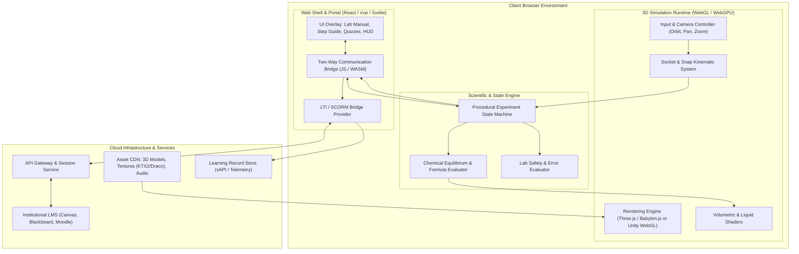
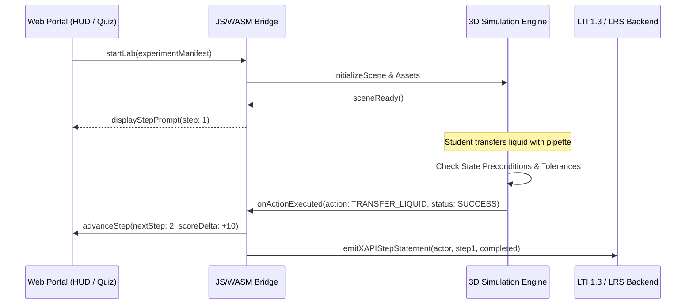

# System Architecture: Interactive 3D Virtual Science Laboratory Platform

## 1. Executive Summary

This document defines the clean-room architectural blueprint for an enterprise-grade, browser-based **Interactive 3D Virtual Science Laboratory Platform** (comparable in capability and pedagogical workflow to platforms such as PraxiLabs and Labster).

The platform enables students to conduct realistic, curriculum-aligned biology, chemistry, and physics laboratory experiments within standard web browsers. It eliminates high-performance hardware barriers, enforces strict laboratory safety and scientific methodology, and integrates seamlessly with institutional Learning Management Systems (LMS).

### Core Architectural Objectives
* **Zero-Install Web Accessibility:** Sub-second interaction latency on standard commodity hardware and consumer laptops via WebGL 2.0 / WebAssembly.
* **Deterministic Procedural Modeling:** Robust state machines for scientific protocols, avoiding erratic rigid-body physics glitches.
* **Declarative Experiment Authoring:** Decoupled experiment definitions (JSON/YAML manifests) allowing instructional designers to author new labs without modifying core engine code.
* **Institutional Interoperability:** Turnkey support for LTI 1.3 Advantage (SSO & Grade Passback), SCORM 1.2/2004, and xAPI (Tin Can) telemetry.

---

## 2. High-Level System Architecture

The platform follows a decoupled, layered topology separating the web shell, real-time 3D simulation runtime, scientific state engine, and backend telemetry/LMS services.



---

## 3. Subsystem Breakdown

### 3.1. 3D Simulation & UX Interaction Model

Rather than allowing unconstrained rigid-body physics (which causes objects to jitter, clip through benches, or spill unpredictably), the simulation uses a **Constrained Kinematic Interaction Model**.

```
[Raycast Hit] ──► [Filter by Layer: "Equipment"] ──► [Evaluate Drag State]
                                                            │
               ┌────────────────────────────────────────────┴────────────────────────────────────────────┐
               ▼                                                                                         ▼
    [No Target Socket in Range]                                                             [Socket Trigger Intersected]
    • Follow mouse projected on ground plane                                                • Render ghost / snap silhouette
    • Clamp to maximum bench boundaries                                                     • On release: Lerp to target position
                                                                                            • Transition state to "Mounted/Docked"
```

#### Key Interaction Components:
1. **Raycaster & Layer Masking:**
   * Only objects marked `Interactable` respond to pointer events.
   * Tooltips and highlight outlines indicate interactive affordances when hovered.
2. **Socket / Mount Point System:**
   * Benches, stands, racks, and hotplates contain predefined 3D coordinate anchors called **Sockets**.
   * Each socket specifies acceptable item tags (e.g., a burette clamp socket accepts only `Tag:Burette`).
   * When an item is released within the snap radius (typically $5\text{–}10\text{ cm}$ in world units), it smoothly interpolates into position and rotation via spherical linear interpolation (Slerp).
3. **Constrained Tools (Pipettes, Burettes, Burners):**
   * Items with internal mechanics use dedicated stateful controllers.
   * A pipette has discrete states: `Empty`, `Aspirating`, `Holding`, `Dispensing`. Volumes and meniscus levels update based on user hold duration or numerical input dialogs.

---

### 3.2. Visual & Shader Systems

To provide high visual fidelity without overloading browser memory limits:

#### A. Liquid & Meniscus Shaders
* **Interior Fluid Mesh:** A dedicated inner geometry scaled slightly smaller than the glass container.
* **Local Plane Clipping:** A custom fragment shader calculates the liquid surface based on a normalized height value:
  $$\text{discard if } P_y > \text{FillHeight}$$
* **Dynamic Color Interpolation:** Chemical indicators (such as phenolphthalein or bromothymol blue) transition color continuously via fragment shaders driven by pH values passed into the material uniforms.

#### B. Apparatus Particle Systems
* Optimized, low-overhead GPU particle emitters represent:
  * Bunsen burner flames (inner blue cone and outer oxidizing flame).
  * Vapor, fuming acids, and steam during heating.
  * Effervescence and gas evolution during chemical reactions.

---

## 4. Declarative Experiment Engine

Each laboratory experiment is defined as a structured, declarative manifest (JSON/YAML). This completely decouples domain-specific curriculum content from 3D engine programming.

### Example Experiment Manifest Schema (`experiment.json`)

```json
{
  "id": "chem_acid_base_titration",
  "title": "Acid-Base Titration (HCl with NaOH)",
  "version": "1.2.0",
  "scene": {
    "environment": "chemistry_lab_standard",
    "benchLayout": [
      { "id": "stand_01", "type": "retort_stand", "position": [0, 0.85, 0] },
      { "id": "flask_01", "type": "erlenmeyer_250ml", "position": [-0.3, 0.85, 0] },
      { "id": "pipette_01", "type": "volumetric_pipette_25ml", "position": [0.4, 0.85, 0] }
    ]
  },
  "initialState": {
    "analyte": { "formula": "HCl", "volume_ml": 25.0, "molarity": 0.100 },
    "titrant": { "formula": "NaOH", "volume_ml": 50.0, "molarity": 0.100 },
    "indicator": "phenolphthalein"
  },
  "procedureSteps": [
    {
      "stepIndex": 1,
      "instruction": "Transfer 25 mL of 0.1M HCl into the Erlenmeyer flask using the volumetric pipette.",
      "prerequisites": [],
      "expectedAction": {
        "actionType": "TRANSFER_LIQUID",
        "source": "pipette_01",
        "target": "flask_01",
        "minVolume": 24.8,
        "maxVolume": 25.2
      },
      "hints": [
        "Select the pipette, immerse it into the HCl beaker, and aspirate to the calibration mark.",
        "Position the pipette over the Erlenmeyer flask and press Dispense."
      ],
      "errorTriggers": [
        {
          "condition": "target != flask_01",
          "message": "Safety Warning: Reagents must only be dispensed into designated receiving vessels.",
          "penalty": 5
        }
      ]
    },
    {
      "stepIndex": 2,
      "instruction": "Add 3 drops of phenolphthalein indicator solution to the flask.",
      "prerequisites": [1],
      "expectedAction": {
        "actionType": "ADD_DROPS",
        "reagent": "phenolphthalein",
        "target": "flask_01",
        "count": 3
      }
    }
  ]
}
```

---

## 5. Bidirectional Web-to-Engine Bridge

The 3D runtime and the surrounding HTML5 web portal communicate through a decoupled messaging interface.



### Event Contracts (TypeScript Definitions)

```typescript
// Outgoing from 3D Simulation Engine to Web Host
export interface LabTelemetryEvent {
  eventType: 'STEP_COMPLETED' | 'SAFETY_VIOLATION' | 'MEASUREMENT_TAKEN' | 'LAB_COMPLETED';
  timestamp: number;
  stepIndex: number;
  payload: {
    scoreAwarded?: number;
    errorType?: string;
    details?: Record<string, unknown>;
  };
}

// Incoming from Web Host to 3D Simulation Engine
export interface LabCommandEvent {
  command: 'RESET_STEP' | 'SET_CAMERA_VIEW' | 'APPLY_HINT_HIGHLIGHT' | 'SET_EXPERIMENT_MODE';
  target?: string;
  parameters?: Record<string, unknown>;
}
```

---

## 6. LMS Integration & Assessment Standards

Modern educational institutions require grade synchronization and compliance auditing through standard protocols:

| Standard | Implementation Purpose |
| :--- | :--- |
| **LTI 1.3 Advantage (Core)** | OIDC Single Sign-On (SSO) directly from Canvas, Blackboard, Brightspace, or Moodle. Eliminates separate student credentials. |
| **LTI AGS (Assignment & Grade Services)** | Automatically synchronizes numeric grades, pass/fail thresholds, and rubric scores to the institutional gradebook upon lab completion. |
| **LTI NRPS (Names & Role Provisioning)** | Provides course rosters and identifies teacher vs. student roles for proctoring and analytics. |
| **xAPI (Experience API / Tin Can)** | Streams high-granularity behavioral events to a central Learning Record Store (LRS) (e.g., student error frequency, time spent per task, hint requests). |
| **SCORM 1.2 / 2004** | Fallback legacy packaging for standalone LMS module distribution (`cmi.core.lesson_status`, `cmi.core.score.raw`). |

---

## 7. Technology Stack Selection & Tradeoffs

For greenfield implementation, two technology tracks are viable:

```
┌─────────────────────────────────────────────────────────────────────────────────┐
│                                Technology Matrix                                │
├───────────────────────────────┬─────────────────────────────────────────────────┤
│ Aspect                        │ Track A: Modern Web 3D (Three.js / Babylon.js)  │ Track B: Game Engine (Unity WebGL / Godot)    │
├───────────────────────────────┼─────────────────────────────────────────────────┼───────────────────────────────────────────────┤
│ Initial Bundle Size           │ Extremely small (3MB - 12MB total)              │ Moderate to heavy (30MB - 80MB+)              │
│ Load & Boot Time              │ 1 - 3 seconds (Instant web app feel)            │ 8 - 25 seconds (WASM parsing + unpack)        │
│ DOM / HTML5 UI Integration    │ Native, seamless React/Vue component overlay    │ Canvas overlay via SendMessage / JSLib bridge │
│ 3D Authoring Pipeline         │ Blender -> glTF 2.0 (Draco / KTX2)              │ Unity Editor Scene graph / Prefab bundles     │
│ Complex Physics / Animation   │ Requires manual setup or Rapier.js / Ammo.js    │ Rich built-in editor physics and animators    │
│ Developer Ecosystem           │ Modern NPM / TypeScript web engineers           │ C# Game Developers                           │
│ Recommended Application       │ Lightweight, high-scalability web EdTech        │ Graphically intensive, legacy 3D lab ports    │
└───────────────────────────────┴─────────────────────────────────────────────────┴───────────────────────────────────────────────┘
```

**Recommendation:** For standard web deployments with high concurrency and accessibility demands across Chromebooks and laptops, **Track A (Three.js / React Three Fiber + TypeScript)** delivers superior load times, easier maintenance, and frictionless LMS embedding.

---

## 8. Implementation Roadmap

```mermaid
timeline
    title Platform Implementation Roadmap
    section Phase 1 : Foundations
        Core 3D Canvas : Orbit camera, lab bench loading, lighting
        Kinematic Snap System : Socket anchors, drag-and-drop raycaster
    section Phase 2 : Scientific Engine
        State Machine : Step validation, prerequisites, error detection
        Dynamic Shaders : Liquid fill height, meniscus, indicator color blending
    section Phase 3 : Declarative Engine
        Manifest Parser : JSON experiment loader, asset dependency manager
        HUD & Guidance : Step prompts, dynamic hints, safety alert modals
    section Phase 4 : Enterprise Integration
        LTI 1.3 Advantage : OIDC auth, Grade passback (AGS)
        xAPI Telemetry : Statement generation, analytics dashboard
```

---

*Document generated for clean-room engineering and technical system design in `edu`.*

